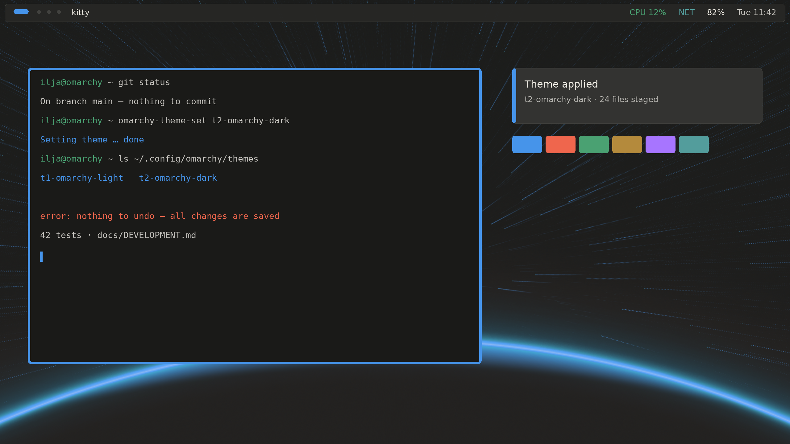

# T2 Omarchy Dark

A dark theme for Omarchy, built on the T1 palette in its dark steps.

- **What it is:** a dark theme for Omarchy, the Arch Linux desktop.
- **What it does:** paints the shell, the bar, the launcher, the notifications and the terminals in warm near-black with a steel-blue accent. Without it the screen glares in a dark room.
- **What it needs:** Omarchy on Arch Linux. Nothing else.
- **How to start:** run `omarchy-theme-install https://github.com/iliFalk/T2-omarchy-dark.git`. It clones the theme and applies it at once.

Inspired by the original [Oxocarbon Dark theme](https://github.com/HANCORE-linux/omarchy-oxocarbon-theme) by HANCORE.

## Install

1. Run `omarchy-theme-install https://github.com/iliFalk/T2-omarchy-dark.git`. Omarchy clones the theme, names it `t2-omarchy-dark` and applies it.
2. To apply it again later, run `omarchy-theme-set t2-omarchy-dark`.

Omarchy takes the name from the repository address: it drops a leading `omarchy-` and a trailing `-theme`, then makes the name lower case. Neither applies here.

To keep a frozen copy instead, download the archive, unpack it into `~/.config/omarchy/themes/t2-omarchy-dark`, then run `omarchy-theme-set t2-omarchy-dark`.

## Use

| Where | What it does |
|---|---|
| Theme menu | `t2-omarchy-dark` applies the palette to the shell, the bar, the launcher and the notifications. |
| Terminal | Alacritty, Ghostty, Kitty and Foot take the T1 colors on the warm near-black ground. |
| Backgrounds | `backgrounds/` holds the horizon wallpaper, `alt-backgrounds/` the alternates. |
| `omarchy-theme-bg-next` | Cycles through the theme backgrounds. |

## Settings

| File | Holds |
|---|---|
| `colors.toml` | The palette. Every other file derives from it. |
| `backgrounds/`, `alt-backgrounds/` | The wallpapers the theme offers. |
| `custom_theme.json` | The same palette in the theme editor's format. |
| `waybar.css`, `mako.ini`, `walker.css`, `swayosd.css` | The bar, the notifications, the launcher and the volume overlay. |
| `preview.png` | A composition of these surfaces on the shipped wallpaper, not a screen capture. |

## Docs

- `docs/DEVELOPMENT.md` — the palette table, the terminal slots, how the steps follow the light palette, the backgrounds and the credits.
- `LICENSE` — MIT.
